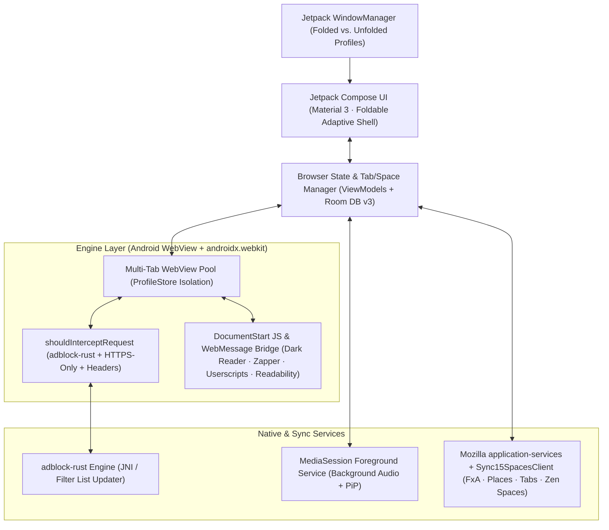

# Swiftfox — Architecture & Implementation Plan

> **Goal:** Build **Swiftfox** (`app.overbay.swiftfox`), a lightweight Material 3 Android browser that combines Chromium's crisp 120Hz text rendering with Firefox/Zen's power-user features: native ad blocking (`adblock-rust`), an Element Zapper, built-in Dark Reader, userscripts & per-site rules, foldable-first ergonomics, and native Firefox/Zen Browser sync.
>
> **Current Status:** Milestones 1, 2, and 3 are implemented on `beta` (`v0.3.0-beta`). Current focus is real-device testing, polish, R8 release verification, and modularization before promoting `beta` to `main` and cutting `v1.0.0`.

---

## 1. Locked-In Decisions

| Area | Decision |
| :--- | :--- |
| **App Name & Package** | **Swiftfox** (`app.overbay.swiftfox`) · Beta side-by-side **Swiftfox Beta** (`app.overbay.swiftfox.beta`) |
| **Android Baseline** | Kotlin + Jetpack Compose + Material 3 · `minSdk 31` (Android 12+) · `targetSdk 35` · `compileSdk 36` |
| **Rendering Engine** | Android `WebView` (`androidx.webkit`) — 120Hz Chromium scrolling + automatic Play Store security patches |
| **Tab / Session Isolation** | `WebView` `ProfileStore` multi-profile: shared normal profile by default, optional per-Space container isolation (`space_<id>`), ephemeral **Private Mode** (`swiftfox_private_session`), and isolated FxA OAuth profile (`FXA_AUTH_PROFILE_NAME`) |
| **Theming (App Chrome)** | Day / Night / System · Night offers **Dark** or **AMOLED Black (`#000000`)** · Accent presets: **Fox Amber Orange** (default), **Midnight Indigo**, **Forest**, **Monochrome** (+ optional Material You toggle) |
| **Web Content Dark Mode** | Decoupled from app theme · Bundled open-source **Dark Reader** JS engine (AMOLED option, brightness/contrast/sepia, auto-skip native dark sites, 1-tap per-site toggle) + Chromium **Algorithmic Darkening** as optional Fast/Lite mode |
| **Foldable Ergonomics** | Jetpack `WindowManager` detects Folded vs. Unfolded · Independent profiles per posture for **Toolbar Placement** (Top / Bottom / Split / Side Rail) and **Default Site Mode** (Mobile vs. Desktop) + per-site overrides · Reloads active tab on fold/unfold only if resolved site mode changes |
| **Tabs & Workspaces** | Zen-inspired **Spaces** + pinned **Essentials** · Visual rounded card grid (folded) + optional collapsible vertical sidebar (unfolded) |
| **Ad Blocking & Zapper** | Embedded **`adblock-rust`** JNI (`arm64-v8a` + `x86_64`, 16 KB page aligned, Kotlin fallback for JVM tests) with uBO/EasyList + custom filter list URLs + native Material 3 **Element Zapper** HUD ("Zap once" with Undo + "Block permanently" with `-/+` parent/child scope slider & rule manager) |
| **Extensibility & Reading** | Userscript engine (`.user.js` with `@match`/`@run-at`/`GM_*` APIs) + per-site rule overrides (cookies, User-Agent presets/custom UA, JS toggle, adblock pause, Dark Reader override) + built-in **Reader Mode** (Mozilla Readability.js + native Compose renderer) |
| **Sync & Logins** | Native **Firefox / Zen Sync** via Mozilla `application-services` (in-app OAuth + CameraX/ZXing QR pairing, Bookmarks, History, Synced Open Tabs, plus Zen Spaces/Essentials/Pinned via custom Sync 1.5 HAWK/AES-GCM client) + Chrome HTML bookmark import/export · **Android System Autofill / Credential Manager** for passwords |
| **Daily-Driver Parity** | Smart search/URL omnibox (**Google** default search engine, configurable + bangs + live suggestions), downloads (+ blob bridge), find-in-page, long-press context menus, file uploads, fullscreen video, **PiP + background media playback**, **external app link control**, **HTTPS-Only + per-site permissions**, **URL bar swipe gestures + pull-to-refresh**, **PDF/Print + Clean URL sharing**, default browser registration |
| **Design System** | Locked Surface Brief (`.impeccable/surfaces/`) + `DESIGN.md` & `.impeccable/design.json` |
| **Delivery Workflow** | `beta` -> `main` Git workflow, `arm64-v8a` default beta APKs (`-IncludeX86` for emulator), GitHub Actions CI |

---

## 2. System Architecture



### Key Architectural Principles
1. **Engine Abstraction Boundary:** Wrap `WebView` interactions inside `engine/` (`BrowserSession`, `TabSessionPool`, `ScriptInjector`) so Compose UI never couples directly to raw Android `WebView` internals.
2. **Configuration-Change Survival (Critical for Foldables):** Declare `android:configChanges="orientation|screenSize|smallestScreenSize|screenLayout|density|keyboard|keyboardHidden|uiMode"` on `MainActivity` so folding/unfolding **never destroys live `WebView` instances** or drops page/video state. Let Compose react to `WindowInfoTracker` / `LocalConfiguration` smoothly in place.
3. **Single-Process Multi-Tab Pool with Smart Suspension:** Keep up to 8 recently visited `WebView` tabs warm in `TabSessionPool`; hibernate older background tabs via `WebView.saveState(Bundle)` + screenshot thumbnail so heavy tab counts stay lightweight on RAM.
4. **Decoupled Local-First Storage:** Room DB v3 (`exportSchema = true`, `app/schemas/`) holds Spaces, Essentials, Tabs, Bookmarks, History, Site Overrides, Downloads, Filter Lists, Zapped Rules, Userscripts, Userscript Storage, Synced Remote Tabs, and Zen Pinned Items. Mozilla Sync reconciles asynchronously without blocking browser startup.

---

## 3. Repository Layout

```text
Swiftfox/
├── app/
│   ├── schemas/                              # Exported Room schema JSONs (v3+)
│   ├── src/
│   │   ├── main/
│   │   │   ├── java/app/overbay/swiftfox/
│   │   │   │   ├── MainActivity.kt               # Edge-to-edge host, PiP, intent routing, fold observer
│   │   │   │   ├── SwiftfoxApp.kt                # App container, ProfileStore cleanup, workers, sync init
│   │   │   │   ├── engine/
│   │   │   │   │   ├── SwiftfoxWebView.kt        # Background-media visibility override
│   │   │   │   │   ├── BrowserSession.kt         # WebView wrapper, ProfileStore, UA/Desktop, WebMessage bridge
│   │   │   │   │   ├── TabSessionPool.kt         # Warm session pool (8 max), state hibernation, profile cleanup
│   │   │   │   │   ├── SwiftfoxWebViewClient.kt  # adblock-rust intercept, HTTPS-Only, app-link policy
│   │   │   │   │   ├── SwiftfoxChromeClient.kt   # Fullscreen video, permissions, file picker, progress
│   │   │   │   │   ├── ScriptInjector.kt         # DocumentStart JS & cosmetic/Dark Reader/userscript injection
│   │   │   │   │   └── BackgroundMediaService.kt # Foreground MediaSession + audio focus
│   │   │   │   ├── features/
│   │   │   │   │   ├── adblock/                  # adblock-rust JNI bridge, Kotlin fallback, filter list updater
│   │   │   │   │   ├── darkreader/               # Dark Reader config, AMOLED presets, native-dark skip
│   │   │   │   │   ├── downloads/                # DownloadManager + Blob/data-URI bridge
│   │   │   │   │   ├── foldable/                 # WindowManager posture observer + site mode resolver
│   │   │   │   │   ├── omnibox/                  # URL/search classifier, suggestions, bangs, history ranker
│   │   │   │   │   ├── reader/                   # Readability extraction + structured HTML block parser
│   │   │   │   │   ├── sharing/                  # Clean URL tracking-parameter sanitizer
│   │   │   │   │   ├── sync/                     # FxA coordinator, Sync15 HAWK/AES-GCM Zen client, HTML codec
│   │   │   │   │   ├── userscripts/              # .user.js parser, @match matcher, GM_* OkHttp/storage bridge
│   │   │   │   │   └── zapper/                   # Element Zapper state controller & selector logic
│   │   │   │   ├── data/
│   │   │   │   │   ├── db/                       # Room v3 entities, DAOs, MIGRATION_1_2, MIGRATION_2_3
│   │   │   │   │   └── prefs/                    # DataStore preferences & posture profiles
│   │   │   │   └── ui/
│   │   │   │       ├── browser/                  # BrowserScreen, BrowserChromeViewport, BrowserViewModel, OmniboxOverlay, StartPage, ScrollCollapse & TabStripTransition
│   │   │   │       ├── previews/                 # Compose previews
│   │   │   │       ├── reader/                   # ReaderModeOverlay (native typography & surface sheet)
│   │   │   │       ├── settings/                 # SettingsScreen, QuickActionsSection, FilterListsOverlay, UserscriptsOverlay, Library
│   │   │   │       ├── sheets/                   # SiteRulesSheet
│   │   │   │       ├── sync/                     # SyncOverlay, QrPairingOverlay, SyncedTabsOverlay, FxAAuthWebView
│   │   │   │       ├── tabs/                     # SpacesTabSwitcher + ArcSpacesSidebar (folded drawer & unfolded rail)
│   │   │   │       ├── theme/                    # Material 3 Day/Dark/AMOLED + 4 accents + BrandMark
│   │   │   │       └── zapper/                   # ZapperHudOverlay + ZappedRulesOverlay
│   │   │   ├── assets/
│   │   │   │   ├── adblock/starter_filters.txt   # Bundled starter rules before first list sync
│   │   │   │   └── js/                           # darkreader, readability, bridges, zapper, gm_shim
│   │   │   └── jniLibs/{arm64-v8a,x86_64}/       # Prebuilt libswiftfox_adblock.so (16 KB aligned)
│   │   ├── beta/res/                             # Swiftfox Beta app name & launcher icon overlay
│   │   ├── test/                                 # JVM unit tests (12 test suites)
│   │   └── androidTest/                          # Instrumentation migration & channel smoke tests
├── native/adblock-jni/                           # Rust JNI crate (Cargo.toml, Cargo.lock, Dockerfile)
├── scripts/                                      # build-apk.{cmd,ps1}, build-adblock-jni.ps1
├── .github/workflows/ci.yml                      # Automated unit tests, androidTest compile, lint
├── AGENTS.md
├── DESIGN.md
├── PRODUCT.md
└── README.md
```

---

## 4. Phased Implementation Roadmap & Status

### Milestone 1 — Core Daily Driver, Material 3 Theming & Foldable UX *(Implemented — `v0.1.0-beta`)*
- Locked Direction Contract in `.impeccable/surfaces/` and generated `DESIGN.md` + `.impeccable/design.json`.
- Multi-tab `WebView` pool surviving fold/unfold config changes, `ProfileStore` Private Mode and optional per-Space container isolation, default Android browser registration, and System Autofill support.
- Day / Night / System + Dark / AMOLED `#000000` + 4 accent presets + Material You.
- Independent Folded vs. Unfolded toolbar placement (Top / Bottom / Split / Side Rail) and default site mode (Mobile / Desktop) with smart fold reload, URL-bar gestures, and Zen Spaces + Essentials.
- Smart Omnibox (Google default + alternatives, bangs, live suggestions), PiP & background media playback, downloads (+ blob bridge), find-in-page, context menus, file upload, fullscreen video, HTTPS-Only, per-site permissions, external app link control, PDF/Print, and Clean URL sharing.

### Milestone 2 — Ad Blocking, Element Zapper, Dark Reader, Userscripts & Reader Mode *(Implemented — `v0.2.0-beta`)*
- Dockerized `cargo-ndk` `adblock-rust` JNI engine (`arm64-v8a` + `x86_64`, 16 KB page aligned) with serialized engine cache (`engine.dat`), Kotlin fallback matcher, EasyList/EasyPrivacy/uBO defaults, custom filter list URLs, WorkManager periodic updates, network blocking, and two-stage cosmetic CSS/scriptlet injection.
- Native Material 3 Element Zapper HUD (`Zap once` + `Undo`, `Block permanently`, `-/+` parent/child scope slider, per-site `ZappedRulesOverlay`).
- Decoupled web-content dark mode: bundled Dark Reader JS engine (AMOLED `#000000`, brightness/contrast/sepia, auto-skip native dark sites, 1-tap per-site bypass) + Chromium Algorithmic Darkening Fast/Lite mode.
- `.user.js` Userscript manager (URL install, local file import, built-in editor, `@match`/`@exclude`/`@run-at`/`@grant`, `GM_addStyle`, `GM_getValue`/`GM_setValue`, OkHttp `GM_xmlhttpRequest`), `SiteRulesSheet` (cookies, User-Agent presets/custom, JS, adblock, Dark Reader, HTTPS bypass, site mode), and built-in Reader Mode (`Readability.js` + `ReaderHtmlParser` + native Compose `ReaderModeOverlay`).

### Milestone 3 — Native Firefox & Zen Browser Sync + Chrome Import *(Implemented — `v0.3.0-beta`)*
- Mozilla `application-services` integration (`service-firefox-accounts`, `browser-storage-sync`, `support-appservices`) with isolated FxA OAuth WebView (`FxAAuthWebViewOverlay`) and CameraX + ZXing QR pairing (`QrPairingOverlay` + manual link fallback).
- Bidirectional encrypted sync for Bookmarks, History, and Synced Open Tabs (`SyncedTabsOverlay`) with WorkManager periodic sync (`SwiftfoxSyncWorker`).
- Zen Browser Spaces, Essentials, and Pinned Items sync via custom Sync 1.5 HAWK + AES-256-CBC/HMAC-SHA256 client (`Sync15SpacesClient`, `SyncCrypto`, `HawkAuth`, `ZenSpacesCodec`).
- Netscape HTML bookmark import/export (`ChromeBookmarkHtmlCodec`) for Chrome interop.

### Next Focus — Verification, Polish & `v1.0.0` Release Gate
- End-to-end daily-driver verification on physical foldable hardware across M1–M3 flows (120Hz scroll, fold/unfold site-mode transitions, adblock/zapper, Dark Reader, userscripts, live Mozilla/Zen Sync + QR pairing).
- Signed release build verification under R8 (`isMinifyEnabled = true`, `proguard-rules.pro` audit).
- Incremental decomposition of `BrowserViewModel.kt` and `BrowserScreen.kt` as polish fixes land.
- Promote verified `beta` milestone to `main` via `/promote` and cut signed `v1.0.0` via `/release`.

---

## 5. Known Technical Risks & Honest Guardrails

> [!IMPORTANT]
> **Android `WebView` Blocking vs. Full MV2 `uBlock Origin`:** `WebViewClient.shouldInterceptRequest()` covers ~90–95% of what uBO blocks (network requests + cosmetic CSS + scriptlets via `document_start`), but Android `WebView` has inherent limits around Service Worker fetches, WebSockets, and POST body inspection. Combining `adblock-rust` with the Userscript engine and per-site cookie/JS/UA rules covers most practical workflows without maintaining a full Chromium fork.

> [!WARNING]
> **Mozilla Accounts OAuth & Zen Sync Schema:** Because Mozilla does not issue custom production FxA `client_id`s to indie Android apps, third-party apps authenticate using Fenix's OAuth flow inside an isolated in-app `WebView`. Mozilla could tighten client rules in the future, and Zen's custom sync schema may evolve. Keeping local Room storage decoupled ensures Swiftfox never loses local data if upstream sync endpoints change.

* **Rust / NDK Toolchain (Solved):** `native/adblock-jni/Dockerfile` + `scripts/build-adblock-jni.ps1` cross-compiles `libswiftfox_adblock.so` inside Docker (`rust:1.85-bookworm` + NDK r27c + `cargo-ndk 3.5.4`) using a committed `Cargo.lock` and 16 KB page-size alignment.
* **Background Media Playback:** Handled via `SwiftfoxWebView.onWindowVisibilityChanged` and `BackgroundMediaService` foreground `MediaSession`.
* **Multi-Profile RAM:** Each active `WebView` `ProfileStore` spawns its own Chromium renderer process. Defaulting normal Spaces to a shared profile (with opt-in container isolation per Space) keeps memory usage bounded.
* **APK Size & Native Libraries:** Mozilla `application-services` bundles `libmegazord.so` (~21 MB per ABI). Default phone builds package `arm64-v8a` only (use `-PincludeX86=true` / `-IncludeX86` for `x86_64` emulators), and release builds apply R8 minification and resource shrinking.
