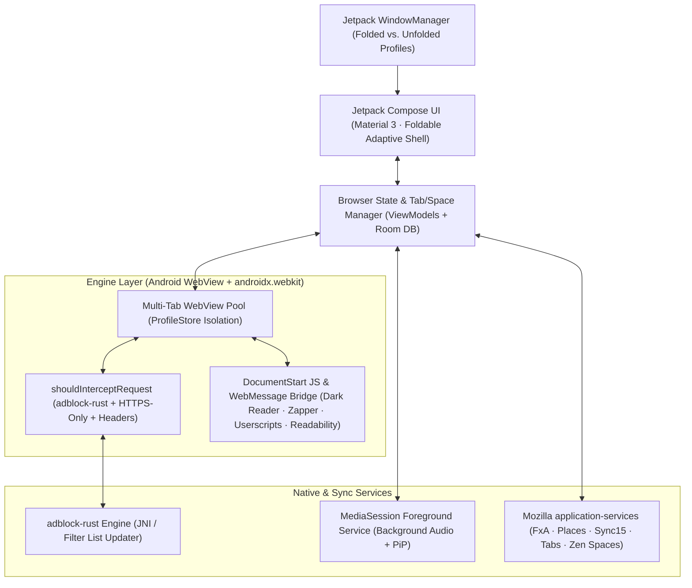

# Swiftfox — Architecture & Implementation Plan

> **Goal:** Build **Swiftfox** (`app.overbay.swiftfox`), a lightweight, Material 3 Android browser that combines Chromium's crisp 120Hz text rendering with Firefox/Zen's best ideas: native ad blocking (`adblock-rust`), a modern Element Zapper, built-in Dark Reader, userscripts & per-site rules, foldable-first ergonomics, and native Firefox/Zen Browser sync.

---

## 1. Locked-In Decisions

| Area | Decision |
| :--- | :--- |
| **App Name & Package** | **Swiftfox** · `app.overbay.swiftfox` · `C:\Docker\Swiftfox` |
| **Android Baseline** | Kotlin + Jetpack Compose + Material 3 · `minSdk 31` (Android 12+) · `targetSdk 35` |
| **Rendering Engine** | Android `WebView` (`androidx.webkit`) — 120Hz Chromium scrolling + automatic Play Store security patches |
| **Tab / Session Isolation** | `WebView` `ProfileStore` multi-profile: shared normal profile by default, optional per-Space container isolation, and fully isolated ephemeral **Private Mode** profile |
| **Theming (App Chrome)** | Day / Night / System · Night offers **Dark** or **AMOLED Black (`#000000`)** · Accent presets: **Fox Amber Orange** (default), **Midnight Indigo**, **Forest**, **Monochrome** (+ optional Material You toggle) |
| **Web Content Dark Mode** | Decoupled from app theme · Bundled open-source **Dark Reader** JS engine (AMOLED option, brightness/contrast/sepia, auto-skip native dark sites, 1-tap per-site toggle) + Chromium **Algorithmic Darkening** as optional Fast/Lite mode |
| **Foldable Ergonomics** | Jetpack `WindowManager` detects Folded vs. Unfolded · Independent profiles per posture for **Toolbar Placement** (Top / Bottom / Split / Side Rail) and **Default Site Mode** (Mobile vs. Desktop) + per-site overrides · Reloads active tab on fold/unfold only if resolved site mode changes |
| **Tabs & Workspaces** | Zen-inspired **Spaces** + pinned **Essentials** · Visual rounded card grid (folded) + optional collapsible vertical sidebar (unfolded) |
| **Ad Blocking & Zapper** | Embedded **`adblock-rust`** (uBO/EasyList + custom filter list URLs) + native Material 3 **Element Zapper** HUD ("Zap once" with Undo + "Block permanently" with `-/+` parent/child scope slider & rule manager) |
| **Extensibility & Reading** | Userscript engine (`.user.js` with `@match`/`@run-at`/`GM_*` APIs) + per-site rule overrides (cookies, User-Agent, JS toggle) + built-in **Reader Mode** (Mozilla Readability.js) |
| **Sync & Logins** | Native **Firefox / Zen Sync** in v1 via Mozilla `application-services` (Bookmarks, History, Open Tabs + Zen Spaces/Essentials) + Chrome HTML bookmark import/export · **Android System Autofill / Credential Manager** for passwords |
| **Daily-Driver Parity** | Smart search/URL omnibox (**Google** default search engine, configurable + bangs + live suggestions), downloads (+ blob bridge), find-in-page, long-press context menus, file uploads, fullscreen video, **PiP + background media playback**, **external app link control**, **HTTPS-Only + per-site permissions**, **URL bar swipe gestures + pull-to-refresh**, **PDF/Print + Clean URL sharing**, default browser registration |
| **Design System Workflow** | **Impeccable (native Android / Material 3):** `PRODUCT.md` (written) → Visual Direction & Surface Brief (`concept-seed --mode operate`) before M1 UI code → Compose Previews + folded/unfolded `adb` screenshots → Finish Review + generated token-accurate `DESIGN.md` & `.impeccable/design.json` |
| **Delivery Workflow** | 3 testable APK milestones (`beta` → `main` Git workflow) |

---

## 2. System Architecture



### Key Architectural Principles
1. **Engine Abstraction Boundary:** Wrap `WebView` interactions behind a `BrowserSession` interface (`loadUrl`, `goBack`, `setDesktopMode`, `injectScript`, `captureThumbnail`) so Compose UI never couples directly to raw Android `WebView` internals.
2. **Configuration-Change Survival (Critical for Foldables):** Declare `android:configChanges="orientation|screenSize|smallestScreenSize|screenLayout|density|keyboard|keyboardHidden|uiMode"` on `MainActivity` so folding/unfolding **never destroys live `WebView` instances** or drops page/video state. Let Compose react to `WindowInfoTracker` / `LocalConfiguration` smoothly in place.
3. **Single-Process Multi-Tab Pool with Smart Suspension:** Keep active + recently visited `WebView` tabs warm in memory; hibernate older background tabs via `WebView.saveState(Bundle)` + screenshot thumbnail so heavy tab counts stay lightweight on RAM.
4. **Decoupled Local-First Storage:** Room DB holds Tabs, Spaces, Essentials, Site Overrides, Zapped Cosmetic Rules, Userscripts, Filter List Subscriptions, and Posture Profiles. Mozilla Sync reconciles Bookmarks, History, Remote Tabs, and Zen Spaces asynchronously without blocking browser startup.

---

## 3. Proposed Repository Layout (`C:\Docker\Swiftfox`)

```text
C:\Docker\Swiftfox\
├── app/
│   └── src/main/
│       ├── java/app/overbay/swiftfox/
│       │   ├── MainActivity.kt               # Edge-to-edge host, PiP, intent routing, fold observer
│       │   ├── SwiftfoxApp.kt                # DI, ProfileStore init, background sync/filter workers
│       │   ├── engine/
│       │   │   ├── BrowserSession.kt         # WebView wrapper, ProfileStore, UA/Desktop mode, state save
│       │   │   ├── SwiftfoxWebViewClient.kt  # adblock-rust intercept, HTTPS-Only, app-link policy
│       │   │   ├── SwiftfoxChromeClient.kt   # Fullscreen video, permissions, file picker, progress
│       │   │   ├── ScriptInjector.kt         # DocumentStart JS & WebMessageListener coordinator
│       │   │   └── BackgroundMediaService.kt # Foreground MediaSession + audio focus
│       │   ├── features/
│       │   │   ├── adblock/                  # adblock-rust JNI wrapper, filter list manager, cosmetic CSS
│       │   │   ├── zapper/                   # Material 3 Zapper HUD + DOM selector JS bridge
│       │   │   ├── darkreader/               # Dark Reader config, AMOLED presets, per-site toggles
│       │   │   ├── userscripts/              # .user.js parser, @match matcher, GM_* native bridge
│       │   │   ├── reader/                   # Mozilla Readability extraction + Reader UI
│       │   │   ├── omnibox/                  # URL/search classifier, suggestions, bangs, history ranker
│       │   │   ├── downloads/                # DownloadManager + Blob/data-URI bridge
│       │   │   └── sync/                     # Mozilla FxA OAuth WebView flow, Places, Sync15, Zen Spaces
│       │   ├── data/
│       │   │   ├── db/                       # Room entities & DAOs (Tabs, Spaces, Rules, Scripts)
│       │   │   └── prefs/                    # DataStore (Theme, Folded/Unfolded profiles, Search, Privacy)
│       │   └── ui/
│       │       ├── theme/                    # Material 3 Day/Dark/AMOLED + Fox Amber/Indigo/Forest/Mono
│       │       ├── browser/                  # Adaptive scaffold (Top/Bottom/Split/Side Rail toolbars)
│       │       ├── tabs/                     # Spaces + Essentials card grid & unfolded vertical sidebar
│       │       ├── sheets/                   # Quick controls sheet (Shield, Dark Reader, Zapper, Site Rules)
│       │       └── settings/                 # Settings screens (Appearance, Foldable, Blocking, Sync)
│       └── assets/js/
│           ├── darkreader.min.js             # Bundled MIT Dark Reader engine
│           ├── readability.min.js            # Bundled Mozilla Readability
│           ├── zapper.js                     # Highlight overlay + smart CSS selector generator
│           └── gm_shim.js                    # Userscript GM_* API bridge
├── native/adblock-jni/                       # Rust crate wrapping brave/adblock-rust via JNI/cargo-ndk
├── AGENTS.md                                 # Swiftfox-specific build/test/release conventions
└── build.gradle.kts
```

---

## 4. Phased Implementation Roadmap (3 Testable APK Milestones)

### Milestone 1 — Core Daily Driver, Material 3 Theming & Foldable UX
**Deliverable:** An installable, daily-drivable browser APK (`v0.1.0-beta`) with full Material 3 theming, foldable ergonomics, Spaces UI, and core Chrome/Firefox parity.

* **Impeccable Design Foundation (Before UI Code)**
  * `PRODUCT.md` captured (`Platform: android`).
  * Run Impeccable's visual direction round (`concept-seed --scope direction --mode operate`) and lock the **Direction Contract** in the primary Surface Brief (`.impeccable/surfaces/`) so typography, tonal density, Fox Amber / Indigo / Forest / Monochrome palette roles, and signature UI craft are locked before writing Compose screens.
* **Project & Engine Core**
  * Scaffold Gradle Kotlin/Compose project (`app.overbay.swiftfox`, `minSdk 31`, `targetSdk 35`, edge-to-edge insets, Git repo with `main` + `beta`).
  * Multi-tab `WebView` pool surviving fold/unfold config changes; `ProfileStore` isolation for Private Mode and optional per-Space containers.
  * Register as Android default browser (`ACTION_VIEW` for `http`/`https`) + Android System Autofill compatibility.
* **Theming & Adaptive Foldable Chrome**
  * Day / Night / System + Dark vs. AMOLED `#000000` + **Fox Amber Orange** (default), **Midnight Indigo**, **Forest**, **Monochrome** (+ optional Material You).
  * Jetpack `WindowManager` posture observer separating **Folded** vs. **Unfolded** profiles:
    * Toolbar placement: **Top**, **Bottom**, **Split**, or **Side Rail** (unfolded).
    * Default site mode: **Mobile** vs. **Desktop** per posture + per-site override; smart reload on fold transition only when site mode changes.
  * URL bar swipe gestures (left/right tab switch, swipe to open switcher) + pull-to-refresh.
* **Spaces, Essentials & Daily-Driver Parity**
  * Tab switcher with Zen-style **Spaces**, pinned **Essentials**, Private toggle, visual card grid (folded), and collapsible vertical sidebar (unfolded).
  * Smart Omnibox: URL vs. search detection, **Google** default search engine (plus DuckDuckGo, Kagi, Brave, Startpage, Custom URL), live search suggestions, open-tab/bookmark/history autocomplete, and keyword bangs (`!w`, `@yt`, etc.).
  * Background media playback + Picture-in-Picture, downloads (+ blob download bridge), find-in-page, long-press context menus, `<input type="file">` picker, fullscreen video, HTTPS-Only mode, per-site permission prompts (camera/mic/location/notifications/DRM), external app link control (`Always in Swiftfox` / `Ask` / `Native app`), Save as PDF/Print, and Clean URL sharing (strips `utm_*`, `fbclid`, `gclid`, `igshid`, etc.).

**M1 Verification & Impeccable Finish Gate:**
* Install debug/beta APK on physical foldable (and/or phone + tablet emulators).
* Verify 120Hz smooth text scrolling, zero page reload when folding/unfolding if site mode is unchanged, and automatic Mobile↔Desktop switch when posture profiles differ.
* Verify Private tab cookies do not leak into normal tabs, YouTube audio continues on screen-off/PiP, bangs & live suggestions work, and external app links respect user policy.
* Capture folded phone, unfolded tablet, AMOLED dark, and `1.3×` font-scale screenshots → run Impeccable's native finish review + documenter to generate the token-accurate **`DESIGN.md` + `.impeccable/design.json`** from the built Material 3 system (which M2 and M3 then inherit).

---

### Milestone 2 — Ad Blocking, Material 3 Element Zapper, Dark Reader, Userscripts & Reader Mode
**Deliverable:** Full power-user customization & blocking suite (`v0.2.0-beta`).

* **Native `adblock-rust` Engine**
  * Compile/bundle `adblock-rust` for `arm64-v8a` (and `x86_64` for emulator) via `cargo-ndk` JNI crate (or verified prebuilt wrapper).
  * Ship default EasyList + EasyPrivacy + uBlock Origin lists with background WorkManager updates + UI to add **custom filter list URLs**.
  * Hook `shouldInterceptRequest` for network blocking + inject matched cosmetic CSS rules at `document_start`.
* **Material 3 Element Zapper**
  * Tap **Zap Element** from the quick-control sheet to enter an interactive inspection mode with a clean Fox Amber rounded highlight border and bottom floating pill HUD.
  * Supports **Zap Once** (immediate removal + Undo snackbar), **Block Permanently** (generates resilient CSS selector, saves to Room per-site rules), **Parent / Child scope slider (`-` / `+`)** to cleanly grab wrapping banners/modals, and a per-site rule viewer/delete manager.
* **Built-in Web Content Dark Mode**
  * Decoupled toggle in Quick Sheet & Theme Settings: **Off / Follow App Theme / Always On**.
  * **Dark Reader Engine** (default): true AMOLED `#000000` option, brightness/contrast/sepia sliders, automatic skip for sites advertising native `color-scheme: dark`, 1-tap per-site bypass.
  * **Fast/Lite Mode** toggle using `WebSettingsCompat.setAlgorithmicDarkeningAllowed()`.
* **Userscript Engine, Per-Site Overrides & Reader Mode**
  * `.user.js` manager: install from URL or local file, parse metadata headers (`@name`, `@match`, `@exclude`, `@run-at`, `@grant`), execute via `addDocumentStartJavaScript` / `onPageFinished`, and bridge `GM_addStyle`, `GM_getValue`/`GM_setValue`, and `GM_xmlhttpRequest` (via OkHttp in Kotlin so CORS works cleanly).
  * Per-site overrides sheet: cookies toggle, custom User-Agent, JavaScript toggle, adblock pause, Dark Reader toggle, Mobile/Desktop lock.
  * **Reader Mode** powered by Mozilla Readability.js, styled natively with Swiftfox's Day/Dark/AMOLED theme and typography controls.

**M2 Verification:**
* Verify ad-heavy news sites load cleanly with network + cosmetic blocking active and custom filter list URLs apply immediately.
* Zap a sticky banner both temporarily (verify Undo restores it, reload brings it back) and permanently (verify reload keeps it gone and rule appears in manager).
* Verify Dark Reader AMOLED mode renders crisp `#000000` backgrounds without inverting photos, skips native dark sites, and toggles per-site cleanly.
* Install a test `.user.js` script using `GM_addStyle` + `GM_xmlhttpRequest` and verify it executes accurately on matching domains.

---

### Milestone 3 — Native Firefox & Zen Browser Sync + Chrome Import
**Deliverable:** Full cross-device sync (`v0.3.0-beta` → `v1.0.0`).

* **Mozilla `application-services` Integration**
  * Integrate Mozilla Maven artifacts (`service-firefox-accounts`, `places`, `sync15`, `tabs`).
  * Build in-app Mozilla Account OAuth sign-in & QR pairing flow via dedicated auth `WebView` redirect interception.
  * Two-way encrypted sync for **Bookmarks**, **History**, and **Synced Open Tabs** (with background WorkManager periodic sync + pull-to-sync).
* **Zen Browser Spaces & Essentials Sync**
  * Inspect and map Zen Browser's encrypted Mozilla Sync workspace/pinned/essentials records into Swiftfox's local Spaces & Essentials (referencing open-source `Kjell6/Z-Sync` patterns and verifying against your live Zen Desktop account).
* **Chrome Bookmark Interop**
  * Standard Netscape HTML bookmark file importer/exporter so Chrome bookmarks can be brought in or backed up cleanly.

**M3 Verification:**
* Sign into your real Mozilla Account on Swiftfox and verify bidirectional sync of a newly created bookmark, history entry, and open tab with Desktop Firefox / Zen Browser.
* Verify Zen Spaces and Essentials populate accurately into Swiftfox's workspace switcher.
* Import a Chrome-exported `bookmarks.html` file and verify folder hierarchy preservation.

---

## 5. Known Technical Risks & Honest Guardrails

> [!IMPORTANT]
> **Android `WebView` Blocking vs. Full MV2 `uBlock Origin`:** `WebViewClient.shouldInterceptRequest()` covers ~90–95% of what uBO blocks (network requests + cosmetic CSS + scriptlets via `document_start`), but Android `WebView` has inherent limits around Service Worker fetches, WebSockets, and POST body inspection. Combining `adblock-rust` with our Userscript engine + per-site cookie/JS/UA rules covers nearly every practical workflow without paying the 150 GB Chromium C++ build tax.

> [!WARNING]
> **Mozilla Accounts OAuth & Zen Sync Schema:** Because Mozilla does not issue custom production FxA `client_id`s to indie Android apps, third-party apps (like Iceraven, IronFox, and Z-Sync) authenticate using Fenix's OAuth flow inside an in-app `WebView`. This works today, though Mozilla could tighten client rules in the future—and Zen's custom sync schema is still evolving. Keeping local Room storage decoupled ensures Swiftfox never loses local data if upstream sync endpoints change.

* **Rust / NDK Toolchain:** Before Milestone 2, we will verify whether your machine has `rustup` + `cargo-ndk` + Android NDK installed (or set up a clean automated build step in WSL2/Windows) for `adblock-rust`.
* **Background Media Playback:** Android `WebView` automatically pauses HTML5 audio/video when backgrounded unless the host overrides `onWindowVisibilityChanged` and holds a foreground `MediaSession` service—we will build this deliberately in M1 rather than treating it as an afterthought.
* **Multi-Profile RAM:** Each active `WebView` `ProfileStore` spawns its own Chromium renderer process. Defaulting normal Spaces to a shared profile (with opt-in container isolation per Space) keeps memory usage snappy.
